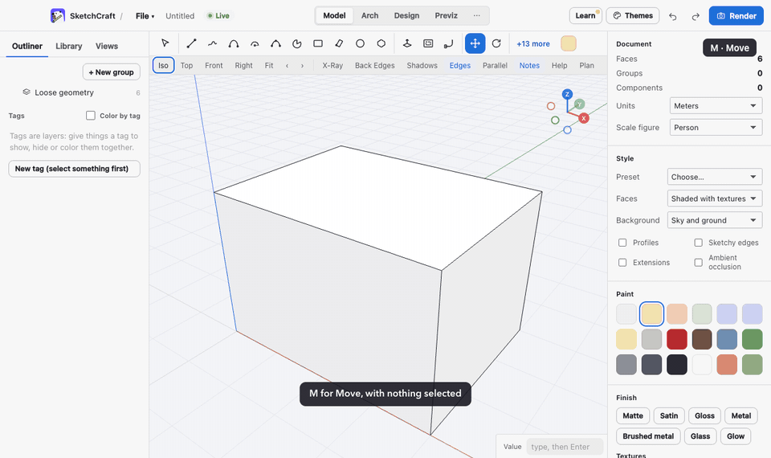
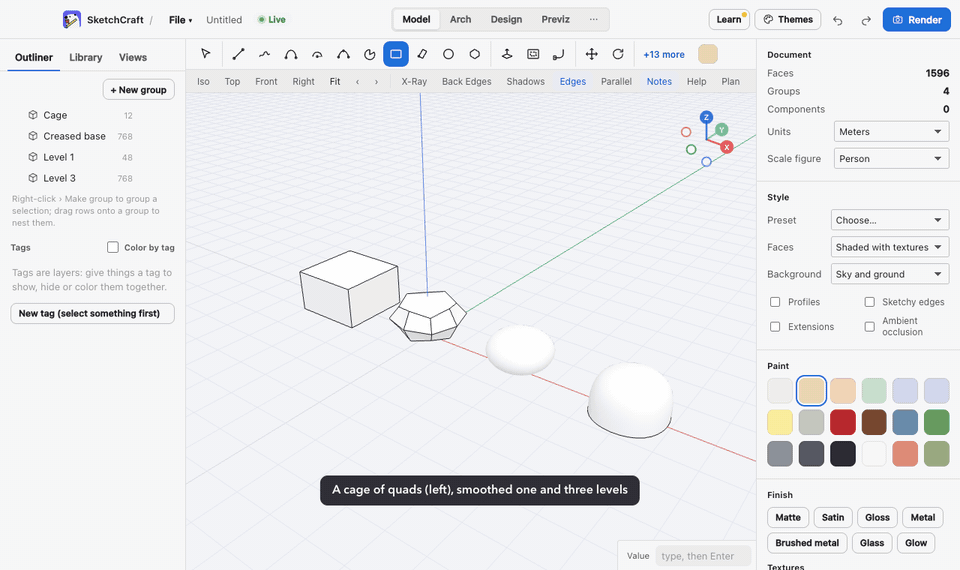
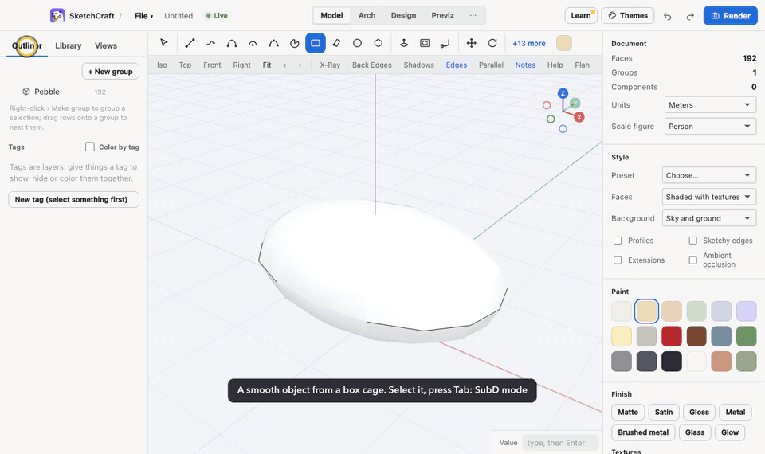
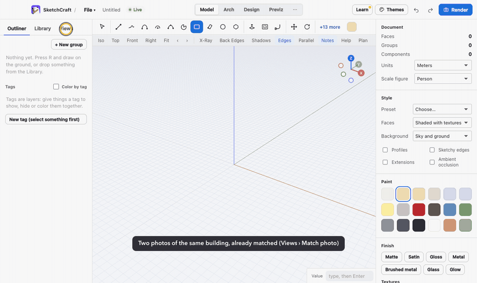

# 3. Shaping

## Push/Pull (P)

Click a face and move: it grows into a solid, or cuts in when you push. Push
a window outline right through a wall to make a hole. Type a distance for an
exact one.

## Move, Rotate, Scale

| Tool | Key | Notes |
| --- | --- | --- |
| Move | M | Option/Ctrl makes a copy; type `x5` after for five copies |
| Rotate | Q | click the center, a start direction, then the angle (snaps to 15°) |
| Scale | S | drag a handle; type `2` for twice the size |
| Offset | F | a face's outline, moved in or out |
| Follow Me | J | sweep a shape along a path: trim, cornices, gutters |

### Move a single corner

With nothing selected, Move grabs the corner under the cursor. Its edges
stretch as you go, and the faces around it fold so every face stays flat. Good
for roofs, ramps and tapered shapes.

## Solids and more

Select two solids (closed groups or components) and right-click: **Union**,
**Subtract**, **Intersect**, **Trim**, **Split** or **Outer shell**. Also:
**Intersect Faces**, **Flip Along**, **Soften** edges, and **Bevel** in the
Design workspace.

## Curved and organic shapes

**Subdivision** smooths a rough cage of faces into a soft shape, the way
Blender's Subdivision modifier does. Open a subdivided object to shape its
cage:

## Terrain

The Sandbox tools shape ground: **Smoove** raises and lowers it, **Stamp**
presses in a flat pad for a building, **Drape** lays lines onto it, and
**Flip edge** fixes a triangle. **Add location…** brings in real terrain and
map imagery.

## Model from photos

Match two photos of the same building, mark the same corners in both, and
SketchCraft works out where they are in 3D. Views › Match photo…, then Model
from photos…

Next: [Organizing](04-organizing.md)
