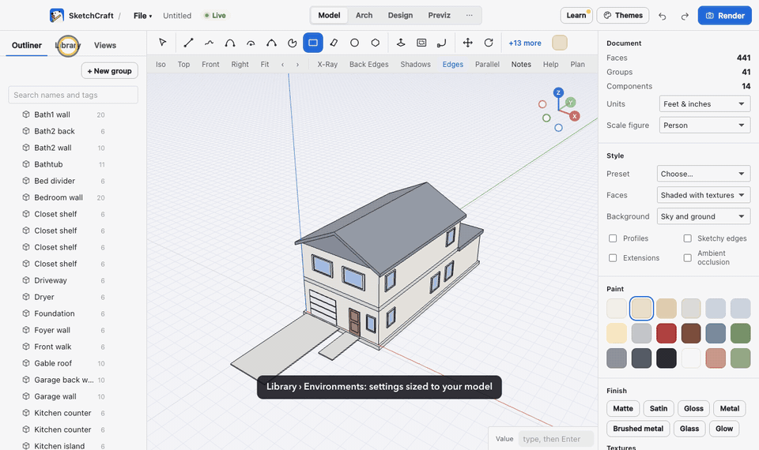
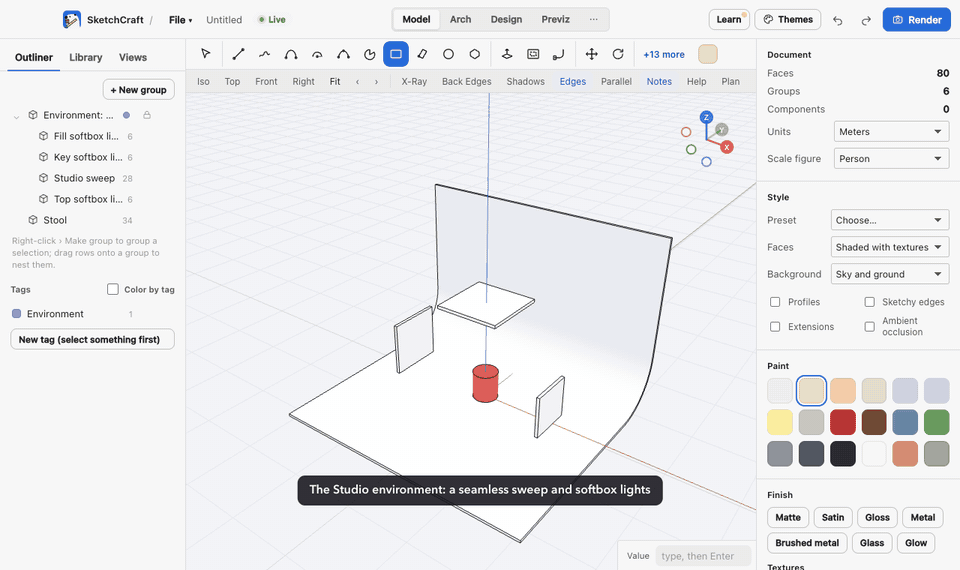

# 6. Presenting

## Styles

**Style** in the right panel: shaded, shaded with textures, physically based,
monochrome, hidden line or wireframe, on a sky, paper, blueprint or night
background. Add profiles, sketchy edges, extensions or ambient occlusion. The
**Preset** list has ready-made looks.

## Scenes

In the **Views** tab, name the view and click **Save**: it remembers the camera,
and the style, hidden things, tags and section cut that go with it (in the
Previz strip, **+ Scene** does the same). Click a saved view to glide back.

## Sections and plans

**X** (Section cut) and click a face to slice the model open. **Plan** in the
view bar cuts a floor plan; in the **Arch** workspace, the floor buttons cut
each floor.

## Settings around the model

**Library › Environments** (or Setting in the Arch and Previz strips) puts the
model on a suburban lot, a city block, a park, a desert or a waterfront.

## Photoreal renders

**Render** (top right) makes a photoreal picture that sharpens while you watch.
Use **Catalog studio** for a neutral, seamless backdrop and soft shadows or **Warm
interior** for warmer light on the geometry you have modeled. Both start with a
4:5 portrait. **Daylight** restores the standard sky and lighting.

Choose **Draft** to check framing. **Production** increases the catalog
output to 1920 × 2400 with 256 samples per pixel. **More settings** offers
other sizes, exposure, sunlight, sky light, shadow softness, sun color,
light bounces, backdrop and ground. Use **Save PNG** on the image you want.
Use **Finish** in the right panel to give a material a matte, satin, glossy,
metallic, glass or glowing finish.

## Video and sun studies

The **Timeline** (Previz workspace) makes turntables, walkthroughs and sun
studies, exported as MP4.

## Drawings

**File › Make blueprint (PDF)** and **Drawing sheets (PDF)** lay out views at
true scale with a title block.

Next: [Themes and workspaces](07-themes.md)
